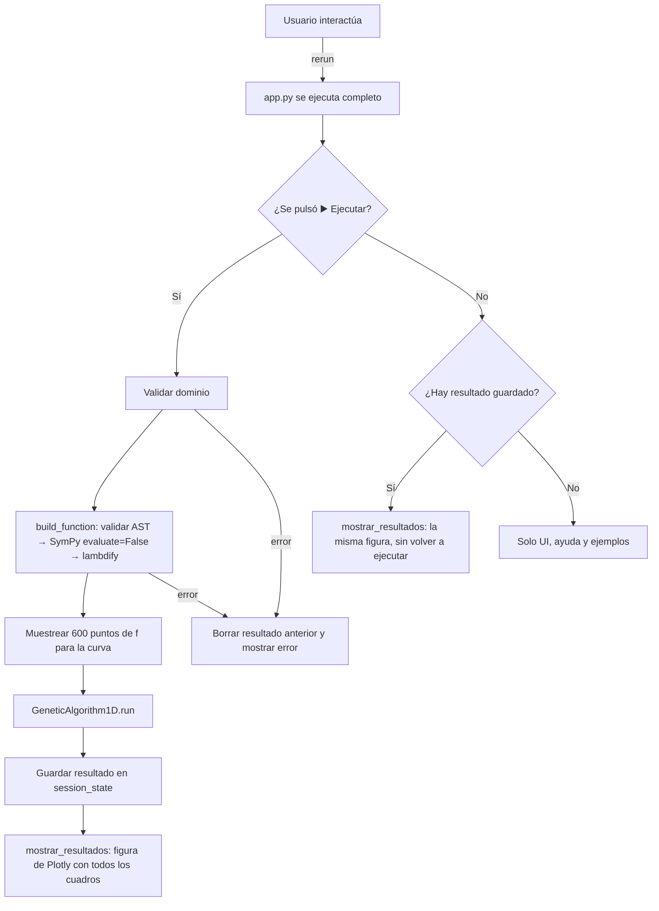

# Documentación técnica — Simulador de Algoritmo Genético 1D

Aplicación web en [Streamlit](https://streamlit.io/) que minimiza una función real de una variable `f(x)` en un intervalo `[a, b]` con un **algoritmo genético (AG)** de codificación real, y anima la evolución de la población generación por generación.

---

## 1. Estructura del proyecto

| Archivo | Rol |
|---|---|
| `app.py` | Interfaz Streamlit: parámetros, ejemplos, animación y resultados. |
| `AG_procesamiento.py` | Motor del AG (`GeneticAlgorithm1D`), validación de expresiones (`validar_expresion`) y parser (`build_function`). No depende de Streamlit. |
| `tests/` | Pruebas `pytest`: motor (`test_ag_procesamiento.py`) y app de punta a punta con `AppTest` (`test_app.py`). |
| `requirements.txt` | Dependencias directas de la app, fijadas a versiones probadas (UTF-8). |
| `requirements-dev.txt` | `requirements.txt` + `pytest`. |
| `.gitattributes` | `* text=auto`: normaliza finales de línea a LF en el repo. |
| `deploy/` | Instalación en un servidor dedicado: script `instalar.sh`, plantilla systemd, lanzador, variables y límites (ver §9). |
| `.streamlit/config.toml` | Tema y ping del websocket. Se aplica al correr Streamlit desde la carpeta del repo. |
| `Caminata aleatoria1v.py` | Versión antigua de escritorio en Tkinter (caminata aleatoria). Está en `.gitignore` y no la usa la app web. |
| `.python-version` | Lo genera `pyenv local`. Está en `.gitignore` porque el nombre del entorno depende de cada máquina. |

---

## 2. Entorno de desarrollo (pyenv)

Entorno creado con **Python 3.12.14** usando `pyenv-virtualenv`. Se requiere Python ≥ 3.11, porque `numpy 2.3` no soporta versiones anteriores.

```bash
pyenv virtualenv 3.12.14 algoritmo-genetico-env
pyenv local algoritmo-genetico-env
pip install -r requirements-dev.txt     # o requirements.txt si no vas a correr pruebas
streamlit run app.py                    # http://localhost:8501
pytest                                  # 83 pruebas, ~10 s
```

**`requirements.txt`**: contiene solo las 4 dependencias directas (`streamlit 1.63.0`, `numpy 2.3.0`, `plotly 7.1.0`, `sympy 1.14.0`). Streamlit instala por su cuenta pandas, pyarrow, altair, etc. Al no fijar las dependencias indirectas, una instalación nueva puede traer versiones más recientes. Si se necesita reproducibilidad exacta, conviene generar un lock (`pip freeze > requirements-lock.txt`, o usar `pip-tools` / `uv`).

---

## 3. Flujo de ejecución

Streamlit **vuelve a ejecutar `app.py` de arriba a abajo** con cada interacción. Para que los resultados sobrevivan a esos reruns, se guardan en `st.session_state.resultado`.



---

## 4. Motor: `AG_procesamiento.py`

### 4.1 Validación y parseo de expresiones

`sympy.sympify` usa `eval` internamente, así que la expresión del usuario **nunca** llega a SymPy sin validarse antes.

**`validar_expresion(expr_str)`** ([AG_procesamiento.py:100](AG_procesamiento.py:100)):

1. Rechaza expresiones de más de `MAX_LONGITUD_EXPRESION = 200` caracteres.
2. Convierte `^` en `**` (`_normalizar`), igual que hace SymPy, y analiza el texto con `ast.parse(..., mode="eval")`. El orden importa: en Python `9^9^9` se agrupa como `(9^9)^9`, pero SymPy lo convierte en `9**(9**9)`. Si se validara el texto sin convertir, el validador calcularía la versión pequeña y dejaría pasar la gigante. Un error de sintaxis se convierte en `ValueError("Sintaxis inválida: ...")`.
3. Recorre el árbol y acepta solo una lista blanca:
   - números `int`/`float` (no `bool`, `complex` ni cadenas);
   - los nombres `x`, `pi`, `sin`, `cos`, `tan`, `exp`, `log`, `sqrt`, `abs`, `Abs`;
   - los operadores `+ - * / **` (y `^`, ya convertido en `**`) y el signo unario;
   - llamadas solo a las funciones de la lista y sin argumentos con nombre.

   Cualquier otra cosa se rechaza: atributos (`().__class__`), `lambda`, listas, `__import__`, otras variables, etc.
4. **`_valor_constante`** evalúa con `float` cada subárbol que no depende de `x`. Si alguno desborda (`9**9**9`, `(9**100)**100`, `exp(1000)`), lanza `ValueError("...constante demasiado grande")`. Sin esto, SymPy intentaba calcular enteros de cientos de millones de dígitos y bloqueaba el servidor.

**`interpretar_expresion(expr_str)`** ([AG_procesamiento.py:384](AG_procesamiento.py:384)):

1. Llama a `validar_expresion`.
2. `sympy.sympify(..., locals=permitidos, evaluate=False)`. Con `evaluate=False`, SymPy **no simplifica**. Sin esa opción, `9**(x - x + 9**9)` se reducía a `9**387420489` y volvía a bloquear el proceso.
3. Rechaza símbolos libres distintos de `x` y devuelve `(expr, x)`.

**`expresion_latex(expr_str)`** ([AG_procesamiento.py:506](AG_procesamiento.py:506)): valida con `interpretar_expresion` y genera el LaTeX **desde el mismo AST ya validado**, con el orden y la forma que escribió el usuario: `1/(1 + exp(-10*x))` → `\frac{1}{1 + e^{-10 x}}`. Se usa para mostrar la fórmula interpretada en la interfaz. No usa `sympy.latex`, que con `evaluate=False` producía cosas como `1 \frac{1}{…}`.

**`build_function(expr_str)`** ([AG_procesamiento.py:516](AG_procesamiento.py:516)): `interpretar_expresion` + `sympy.lambdify(x, expr, "numpy")` con un envoltorio `np.errstate(all="ignore")`.

### 4.2 `GeneticAlgorithm1D`

**Representación:** cada individuo es un real `x ∈ [a, b]`. El problema es de **minimización**; internamente el fitness es `-f(x)`.

| Parámetro | Por defecto (clase / app) | En la UI | Significado |
|---|---|---|---|
| `f` | — | Función f(x) | Función objetivo |
| `bounds` | — / `(-10, 10)` | Límites del dominio | Dominio `[a, b]` |
| `pop_size` | 30 / 50 | Tamaño de población | Individuos por generación |
| `pc` | 0.8 | pc | Probabilidad de crossover |
| `pm` | 0.1 | pm | Probabilidad de mutación |
| `sigma` | 0.1 | Sigma relativo | `σ₀ = sigma·(b−a)` |
| `generations` | 200 / 80 | Cantidad de generaciones | Iteraciones evolutivas |
| `tournament_k` | 3 | Avanzados → k | Tamaño del torneo |
| `sigma_decay` | 0.99 | Avanzados → γ | `σ_t = σ₀·γᵗ` |
| `random_state` | `None` / 42 | Fijar semilla + Semilla | Semilla de `np.random.default_rng`; `None` = aleatoria |

**Ciclo de `run()`** ([AG_procesamiento.py:331](AG_procesamiento.py:331)):

1. **Reinicio** del estado, para poder reutilizar el objeto.
2. **Inicialización:** `pop_size` valores uniformes en `[a, b]`.
3. **Evaluación** (`evaluate`): `f` en cada individuo. Los errores, `nan` e `inf` se convierten en `+inf` (penalización). Actualiza el mejor histórico y guarda `history`, `values_history` y `best_history`.
4. Si **ningún** individuo de la generación 0 tiene `f(x)` finito, lanza un `ValueError` claro (“La función no tiene valores finitos en ningún individuo de la población inicial…”).
5. Repite `generations` veces:
   - **Elitismo:** el mejor histórico pasa directo.
   - **Torneo:** `k` individuos distintos al azar; gana el de mayor fitness.
   - **Crossover aritmético:** con prob. `pc`, `hijo = α·p1 + (1−α)·p2`, `α ~ U(0,1)`; si no, `hijo = p1`.
   - **Mutación gaussiana:** con prob. `pm`, `x += N(0, σ_t)`; después siempre se aplica `np.clip` a `[a, b]`.
   - `σ ← σ·γ`, luego se vuelve a evaluar.
6. Devuelve `(best_x, best_f, history, best_history)`. Además, `ag.values_history` contiene los `f(x)` de cada población, ya calculados, para que la app no tenga que volver a evaluarlos.

**Costo:** `pop_size × (generations + 1)` evaluaciones de `f` (≈ 4 050 por defecto, ~0.35 s).

---

## 5. Interfaz: `app.py`

### 5.1 Estructura de la página

La página sigue el orden de la tarea. Primero se define el problema, luego aparece la gráfica y al final los detalles. La acción principal está en el área principal, así que también se ve en un móvil, donde la barra lateral está cerrada.

| Zona | Contenido |
|---|---|
| Encabezado | Título y una línea que explica qué hace la app. |
| Definición del problema | **Función f(x) a minimizar** (la sintaxis está en el ícono de ayuda) y selector **Ejemplo**, con la descripción del ejemplo elegido. Debajo, **Límite inferior (a)**, **Límite superior (b)** y el botón principal **▶️ Ejecutar simulación** (`type="primary"`). |
| Validación en vivo | Si todo es válido, la fórmula interpretada en **LaTeX** (`st.latex`). Si no, el error justo debajo de los campos: sintaxis, nombres no permitidos, dominio invertido o función sin valores en el dominio. Si se pulsa **Ejecutar** con un error, no se ejecuta y aparece el aviso “Corrige el error indicado arriba…”. El botón no se deshabilita (ver §7). |
| Avisos | Si cambió un **parámetro del algoritmo** desde la última ejecución: “Cambiaste parámetros…”, y los resultados siguen visibles. Si cambió la **función o el dominio**: “La función o el dominio cambiaron…”, y en lugar de los resultados se ve la vista previa. Al volver al problema anterior, los resultados reaparecen. |
| Gráfica | Antes de ejecutar: **vista previa** de f(x) en Plotly. Después: una figura de Plotly con la población (arriba) y la convergencia del mejor valor (abajo), los botones **▶ Reproducir**, **⏸ Pausa** y **⏮ Inicio**, y el control deslizante **Generación**. La animación se reproduce **en el navegador** (ver §5.3). |
| Resultados | Mensaje «Simulación completada. Pulsa ▶ Reproducir…» (solo justo después de ejecutar); leyenda con la función, el dominio y la semilla; 3 métricas; **🗑️ Limpiar resultados**. |
| Al final | Expanders “Cómo usar el simulador” y “Fundamento teórico”. |
| Barra lateral | **🧬 Algoritmo**: población (4–500), generaciones (1–500), `pc`, `pm`, `sigma`. **🔧 Avanzado** (expander): `k`, `γ`, casilla y valor de la semilla. **🎞️ Visualización**: **Velocidad de la animación**, **Lenta / Normal / Rápida** (250 / 100 / 40 ms por cuadro del botón ▶ Reproducir). |

**Ejemplos.** `EJEMPLOS` tiene 13 entradas con `nombre`, `expr`, `dominio` y `descripcion`. Al elegir uno (`aplicar_ejemplo`) se cargan la función **y su dominio sugerido**: por ejemplo, Doble pozo en [−2, 2] y Valles múltiples en [2.7, 7.5]. Si el usuario edita la función, el selector pasa a “— Personalizada —” (`marcar_personalizada`). La función, el ejemplo y el dominio se inicializan con `st.session_state.setdefault` y no con `value=`, porque los cambia un callback.

### 5.2 Funciones auxiliares

| Función | Rol |
|---|---|
| `evaluar_vector_seguro(f, xs)` | Evalúa la curva punto a punto; los errores se convierten en `NaN`. |
| `preparar_problema(expr, a, b)` | `@st.cache_data`. Valida, obtiene el LaTeX y muestrea la curva. Lanza `ValueError` si la función no tiene al menos 2 puntos válidos en el dominio. |
| `evaluar_problema(expr, a, b)` | Devuelve `(problema, error)`. También cubre la función vacía y el dominio invertido. |
| `figura_vista_previa(problema, expr, a, b)` | Figura de Plotly con la curva antes de ejecutar. |
| `aplicar_ejemplo()` / `marcar_personalizada()` | Callbacks del selector de ejemplos y del campo de la función. |
| `format_value(v)` | 6 decimales o `"N/A"`. |
| `limpiar_resultados()` | Borra `st.session_state.resultado`. |
| `generaciones_animadas(total)` | Generaciones que van como cuadros: como máximo `MAX_FRAMES_ANIMACION = 100`, espaciadas, siempre con la 0 y la última. |
| `titulo_generacion(resultado, gen)` | “Generación g/G · Mejor histórico: …”. |
| `trazas_generacion(resultado, gen)` | Las 4 trazas que cambian en cada cuadro: población, ★, marcador de la convergencia y texto de la generación. |
| `figura_animacion(resultado, duracion_ms)` | Figura de Plotly con 2 filas, los cuadros, los botones y el control deslizante (ver §5.3). |
| `mostrar_resultados(resultado, recien_ejecutado, duracion_ms)` | Dibuja la sección de resultados: mensaje de éxito, la figura (`st.plotly_chart`, key `animacion_<id>`), métricas y **Limpiar resultados**. |

**Detección de resultados desactualizados.** Cada resultado guarda `problema = (expr, a, b)` y `parametros`: población, generaciones, `pc`, `pm`, `σ`, `k`, `γ` y semilla. En cada rerun se comparan con los valores actuales. La animación y su velocidad no cuentan, porque no cambian el resultado.

### 5.3 Animación con Plotly

Antes, la animación era un ciclo **en el servidor**: por cada generación dibujaba una imagen con Matplotlib, la mandaba al navegador y esperaba con `time.sleep`. Tenía tres problemas:

- Cualquier re-ejecución de Streamlit (por ejemplo, el campo de la función confirmándose al hacer clic) cortaba el ciclo.
- Las imágenes viajaban una por una por el websocket; a través de Cloudflare llegaban tarde o juntas y a veces la animación no se veía.
- Ocupaba el servidor durante toda la animación (~65 ms por cuadro) y no se podía pausar.

Ahora `figura_animacion` construye **una sola figura de Plotly** con todas las generaciones como `frames`, y el navegador la reproduce:

| Traza | Fila | Cambia por cuadro |
|---|---|---|
| 0 · curva de f(x) | 1 | no |
| 1 · población | 1 | sí |
| 2 · ★ mejor histórico | 1 | sí |
| 3 · convergencia del mejor valor | 2 | no |
| 4 · marcador de la generación actual | 2 | sí |
| 5 · texto “Generación g/G · Mejor histórico…” | 1 | sí |

- Cada `go.Frame` actualiza solo las trazas 1, 2, 4 y 5 (`traces=[1, 2, 4, 5]`).
- **▶ Reproducir** usa `redraw=False` y una transición `cubic-in-out` (70 % de la duración del cuadro), así que los puntos se **desplazan** en lugar de saltar. La duración viene de la barra lateral.
- Con `redraw=False` Plotly no actualiza el título; por eso el texto de la generación es una traza de texto (5) y no el título.
- **⏸ Pausa** y **⏮ Inicio** usan `animate` con duración 0; el control **Generación** tiene un paso por cuadro.
- Plotly no permite que la animación arranque sola: después de ejecutar, la figura muestra la generación 0 y el mensaje de éxito pide pulsar **▶ Reproducir**.
- La velocidad no cuenta como parámetro: cambiarla vuelve a dibujar la figura sin marcar los resultados como desactualizados.

---

## 6. Verificación

**Pruebas automatizadas** (`pytest`, 83 pruebas, todas pasan):

- `test_ag_procesamiento.py`:
  - Los ejemplos y sus variantes (`x^2`, espacios iniciales, `Abs`) se aceptan.
  - 13 entradas maliciosas o inválidas se rechazan.
  - Las constantes enormes se rechazan, también escritas con `^` (`9^9^9`), y `9**(x - x + 9**9)` ya no bloquea el proceso.
  - El LaTeX generado es correcto: fracciones, potencias, valor absoluto, paréntesis y signos.
  - El AG encuentra el mínimo real (malla de 200 001 puntos, tolerancia 10⁻²) en los 12 ejemplos originales.
  - Los historiales quedan alineados y dentro del dominio.
  - El elitismo garantiza que el mejor histórico nunca empeora, y la semilla hace los resultados reproducibles.
  - `sigma_decay` y `tournament_k` se aplican, y los casos de error dan mensajes claros.
- `test_app.py` (con `AppTest`):
  - La pantalla inicial muestra la fórmula y la vista previa, y **Ejecutar** está en el área principal.
  - La ejecución funciona con los valores por defecto y sin semilla.
  - La figura trae un cuadro por generación con su texto, los tres botones y un paso del control por cuadro; con 250 generaciones se limita a 100 cuadros (con la 0 y la última).
  - La velocidad cambia la duración de los cuadros sin invalidar los resultados.
  - Los resultados persisten al mover un parámetro y se muestra el aviso de desactualizados.
  - Al cambiar la función se ve la vista previa, y los resultados vuelven al restaurarla.
  - Los 13 ejemplos son válidos y cargan su dominio; editar la función pasa el selector a “Personalizada”.
  - Dominio invertido, función inválida y función sin valores en el dominio se avisan y, al pulsar **Ejecutar**, no se ejecuta la simulación.
  - Corregir la función y pulsar **Ejecutar** en el mismo paso ejecuta con un solo clic (regresión).
  - Una expresión maliciosa **no** llega a ejecutarse: se comprueba que no crea un archivo.

**Resultados del AG** (dominio `[-10, 10]`, 50 individuos, 80 generaciones, semilla 42):

| Ejemplo | best_x | best_f | mínimo real |
|---|---:|---:|---:|
| Parábola | 0.0000 | 0.0000 | 0.0000 |
| Seno | −3.7499 | −1.0000 | −1.0000 |
| Gaussiana | 10.0000 | 0.0000 | 0.0000 |
| Valor absoluto | 0.0000 | 0.0000 | 0.0000 |
| Doble pozo | 1.0000 | 0.0000 | 0.0000 |
| Múltiples mínimos | 9.8970 | −9.8965 | −9.8965 |
| Logarítmica | 0.0000 | 0.0000 | 0.0000 |
| Sinusoidal | 4.7124 | −1.0000 | −1.0000 |
| Pendiente con oscilación | −8.9129 | −1.8907 | −1.8907 |
| Valles múltiples | −7.9981 | −1.9887 | −1.9887 |
| Terreno irregular | 6.0752 | −0.9985 | −0.9985 |
| Escalón sigmoide | −10.0000 | 0.0000 | 0.0000 |

**Rendimiento** (servidor; la animación ya no consume tiempo del servidor):

| Corrida | Matplotlib en el servidor | Plotly en el navegador |
|---|---:|---:|
| Por defecto (50 × 80): ejecutar y mostrar | 7.7 s con la animación | 0.2 s; figura de 0.16 MB |
| Peor caso (500 × 500) | ~26 s del AG + animación | 5.5 s; figura de 1.3 MB (100 cuadros) |
| Cambiar de generación | ~0.6 s (re-ejecución) | instantáneo (en el navegador) |

**Prueba en navegador real** (Playwright + Edge, clics de mouse): tras pulsar ▶ Reproducir, el texto recorre las 81 generaciones y los puntos cambian de posición en los 4 casos —primera ejecución, fórmula cambiada con Enter, fórmula cambiada sin Enter y cambio de ejemplo—, 2 veces cada uno. Con la animación anterior, después de cambiar la fórmula la animación a veces no se movía.

---

## 7. Cambios aplicados

| Problema detectado | Corrección |
|---|---|
| 🔴 **Ejecución de código arbitrario** desde el campo f(x): `sympify` usa `eval` | Lista blanca sobre el AST (`validar_expresion`) antes de llamar a SymPy. |
| 🔴 **Bloqueo del servidor** con `9**9**9` o `9**(x - x + 9**9)` | `_valor_constante` acota las constantes y se usa `sympify(..., evaluate=False)`. |
| 🔴 **Bloqueo con `^`**: el validador analizaba `9^9^9` como `(9^9)^9` (pequeño), pero SymPy lo convierte en `9**(9**9)` | `_normalizar` convierte `^` en `**` **antes** de validar, así que se analiza exactamente lo que se calculará. |
| 🔴 Población y generaciones sin máximo: cualquiera podía lanzar corridas de horas | Límite de 500 en cada una (peor caso 500 × 500 ≈ 26 s). |
| 🔴 `sympy` faltaba en `requirements.txt`, que además estaba en UTF-16 con 44 paquetes fijados | Regenerado en UTF-8 con las 4 dependencias directas; nuevo `requirements-dev.txt`. |
| 🟠 Ejemplo “Doble pozo” con un paréntesis de más | `"(x**2 - 1)**2"`. Los ejemplos ahora son una lista `EJEMPLOS` (100 líneas repetidas → un bucle). |
| 🟠 “🔄 Ejecutar otra simulación” en realidad borraba los resultados | Se reemplazó por **🗑️ Limpiar resultados**, que hace lo que dice. |
| 🟠 Los resultados desaparecían al mover cualquier control | Se guardan en `st.session_state`; los reruns los muestran sin repetir la animación. |
| 🟠 `RuntimeError` engañoso si ningún individuo inicial era válido | `ValueError` con un mensaje claro en `run()`. |
| 🟠 La semilla decía “(opcional)” pero siempre se usaba | Casilla **Fijar semilla aleatoria**; desmarcada pasa `None`. |
| 🟠 **UX** (auditoría, puntos 1–9): el botón de ejecutar estaba al final de la barra lateral (invisible en el móvil), los resultados quedaban debajo de 12 botones y 2 expanders, la pantalla inicial no mostraba nada, los errores aparecían lejos del campo y al ejecutar, los ejemplos no ajustaban el dominio, los resultados viejos no se marcaban y la animación no se podía omitir | Área principal con función, ejemplo, dominio y botón principal; gráfica justo debajo y teoría al final; vista previa de f(x); validación en vivo con LaTeX y aviso si se pulsa Ejecutar con un error; 13 ejemplos con dominio y descripción en un selector; avisos de resultados desactualizados; casilla **Animar** y velocidad **Lenta / Normal / Rápida**; barra lateral agrupada en Algoritmo / Avanzado / Visualización. |
| 🟡 El fundamento teórico describía `σ` constante y no mencionaba `k` | Texto actualizado (`σ_t = σ₀γᵗ`, torneo con `k`); `γ` y `k` expuestos en “Parámetros avanzados”. |
| 🟡 Animación lenta | Blitting, como máximo 100 frames, métricas antes de la animación; se dejó de evaluar `f` dos veces (`values_history`). Reemplazada después por Plotly (siguiente fila). |
| 🟠 **La animación a veces no se movía** (sobre todo la primera vez tras cambiar la fórmula) y no se podía pausar | Animación con `frames` de Plotly, reproducida en el navegador (§5.3): botones ▶/⏸/⏮, control de generación, convergencia en la misma figura y valores al pasar el mouse. Se quitó la casilla **Animar la evolución**; `matplotlib` se reemplazó por `plotly` en `requirements.txt`. |
| 🟡 Tras un error, seguían visibles los resultados anteriores | Un error borra el resultado guardado. |
| 🟠 **A veces Ejecutar no iniciaba**: con un error en la función, al corregirla y hacer clic directamente en el botón (deshabilitado por el error), el navegador confirmaba el texto y registraba el clic con el botón aún deshabilitado; el clic se perdía y había que pulsar dos veces | El botón ya no se deshabilita. Si se pulsa con un error, no se ejecuta y se muestra un aviso. Prueba de regresión `test_corregir_la_funcion_y_ejecutar_con_un_solo_clic`. |
| 🟡 README desactualizado, cortado y con enlace a otro repo | Reescrito para el AG, con instalación, uso y pruebas. |
| 🟢 `__pycache__/` versionado y ruido CRLF/LF en `git status` | `.gitignore` actualizado y `.gitattributes` con `* text=auto`. Los archivos editados quedaron en LF, como en el repo. |
| 🟢 Sin pruebas | 83 pruebas `pytest`. |
| 🟢 Streamlit 1.45.1, con `use_container_width` en vías de desaparecer | Actualizado a **Streamlit 1.63.0** (y matplotlib 3.10.8): `use_container_width=True` → `width="stretch"`. El mensaje de éxito usa `icon="✅"`, porque 1.63 separa el emoji inicial del texto. Las pruebas corren sin avisos de deprecación. |

---

## 8. Recomendaciones pendientes

Ninguna es un error; son mejoras opcionales:

1. **UX, fase 2** (puntos 10–13 de la auditoría):
   - métricas más informativas (mínimo de referencia y error, generación en que se alcanzó el mejor valor);
   - revisar la figura de Plotly en el móvil (altura y tamaño del texto);
   - `st.toast` en lugar del mensaje de éxito;
   - tabla de “Parámetros usados” y descarga del historial en CSV.
2. **Operadores del AG:**
   - **BLX-α** (`α ∈ [−0.5, 1.5]`) en vez del crossover aritmético, que solo genera hijos *entre* los padres y contrae la población.
   - **Reflexión** en los bordes en vez de `np.clip`, que acumula individuos exactamente en los límites.
   - **Parada temprana** si el mejor valor no mejora en `n` generaciones.
3. **Lock de dependencias** si se necesita reproducibilidad exacta del entorno (ver §2).
4. **Vectorizar la evaluación.** `evaluate_individual` llama a `f` punto a punto (~85 µs por individuo). Evaluar la población completa como un arreglo de NumPy (con respaldo punto a punto si falla) acelera el motor varias veces y permitiría subir los límites de 500.

---

## 9. Despliegue en producción

La app corre como servicio systemd `streamlit@genetico`, que escucha solo en `127.0.0.1:8516`. Un **Cloudflare Tunnel** la publica con HTTPS en **https://genetico.streamlytics.stream** sin abrir puertos de entrada. El destino es un servidor dedicado: una instancia **AWS EC2** con Ubuntu Server 24.04 LTS.

```mermaid
flowchart LR
    U[Navegador] -->|HTTPS| CF[Cloudflare<br/>DNS genetico → túnel, con proxy]
    CF -->|túnel saliente| CD[cloudflared<br/>en la instancia]
    CD -->|http://127.0.0.1:8516| S[streamlit@genetico]
    S --> A[app.py + .venv]
```

### 9.1 Archivos

| Archivo | Destino en el servidor | Función |
|---|---|---|
| `deploy/instalar.sh` | — | Instala todo: paquetes, swap, `.venv`, servicio y, opcionalmente, `cloudflared`. Se puede volver a ejecutar para actualizar. |
| `deploy/streamlit@.service` | `/etc/systemd/system/` | Plantilla systemd. Su `WorkingDirectory` es el repo, para que se lea `.streamlit/config.toml`. |
| `deploy/run_streamlit.sh` | `/usr/local/bin/` | Lanzador. Fija `--server.address=127.0.0.1`. |
| `deploy/genetico.env` | `/etc/streamlit/genetico.env` (`root:ubuntu`, `640`) | Python de `.venv`, `app.py`, puerto 8516 y `--client.showErrorDetails=none` (no muestra tracebacks a los visitantes). |
| `deploy/limites.conf` | `/etc/systemd/system/streamlit@genetico.service.d/` | Como máximo 1 núcleo, `MemoryHigh=400M`, `MemoryMax=512M`. |
| `.streamlit/config.toml` | (en el repo) | Tema y `websocketPingInterval = 30`, para que Cloudflare no cierre el websocket. |

> `instalar.sh` se niega a correr si ya existe una plantilla `streamlit@.service` distinta (un servidor compartido con otras apps), para no afectarlas.

### 9.2 Crear la instancia EC2 (consola de AWS)

Región **us-east-2 (Ohio)**. *EC2 → Lanzar instancia*:

| Campo | Valor |
|---|---|
| Nombre | `genetico` |
| Imagen (AMI) | **Ubuntu Server 24.04 LTS**, arquitectura **64 bits (Arm)**. El script requiere Python 3.11–3.13; versiones más nuevas de Ubuntu traen un Python para el que no hay builds de las dependencias fijadas. |
| Tipo de instancia | `t4g.micro` (2 vCPU, 1 GB) |
| Par de claves | No hace falta si te conectas con EC2 Instance Connect. |
| Red | VPC predeterminada, con *Asignar IP pública automáticamente* **habilitado**: la instancia necesita salir a Internet. |
| Grupo de seguridad | Uno nuevo, con **una sola regla de entrada**: SSH (22) con origen la lista de prefijos `com.amazonaws.us-east-2.ec2-instance-connect`, para conectarte desde la consola. El tráfico web entra por el túnel, así que no hace falta abrir nada más. |
| Almacenamiento | 8–20 GB gp3 |
| Detalles avanzados → *Especificación de crédito* | **Estándar**: si se agotan los créditos de CPU, la instancia se ralentiza en lugar de cobrar extra. |

### 9.3 Instalar la app

*Instancia → Conectar → EC2 Instance Connect → Conectar* abre una terminal en el navegador como el usuario `ubuntu`:

```bash
git clone https://github.com/xaw624/Algoritmo_Genetico.git ~/Algoritmo_Genetico
bash ~/Algoritmo_Genetico/deploy/instalar.sh
```

Tarda unos minutos, sobre todo por `pip`. Debe terminar con `La app responde en http://127.0.0.1:8516`.

### 9.4 Conectar el Cloudflare Tunnel

El servidor usa su propio túnel:

1. En Cloudflare: *Zero Trust → Networks → Tunnels → Create a tunnel* → tipo **Cloudflared** → nombre `genetico-aws`.
2. En *Install and run a connector*, elige Debian / arm64 y copia el **token**: la cadena larga que aparece después de `service install`. Es una credencial: no la compartas ni la guardes en el repo.
3. En la instancia, ejecuta el comando **empezando con un espacio**; así no queda en el historial de bash:

   ```bash
    CLOUDFLARE_TUNNEL_TOKEN='<token>' bash ~/Algoritmo_Genetico/deploy/instalar.sh
   ```

   El túnel debe aparecer como *Healthy* en Cloudflare.
4. **Probar con un hostname temporal.** En el túnel, *Public hostname* (o *Published application routes*): `genetico-aws.streamlytics.stream` → tipo `HTTP` → `127.0.0.1:8516`. Ábrelo en el navegador y ejecuta una simulación.
5. **Pasar el dominio definitivo:**
   - En DNS, borra el registro `genetico` que apunta al túnel anterior.
   - En el túnel nuevo, agrega `genetico.streamlytics.stream` → `http://127.0.0.1:8516`. Cloudflare crea el registro DNS.
   - Entre esos dos pasos el sitio queda fuera unos segundos.
   - Al final, borra el hostname temporal.

### 9.5 Retirar la app del servidor anterior

Cuando el dominio ya responda desde AWS, ejecuta en el servidor anterior:

```bash
sudo systemctl disable --now streamlit@genetico
sudo rm -r /etc/streamlit/genetico.env /etc/systemd/system/streamlit@genetico.service.d
sudo systemctl daemon-reload
```

La regla de `genetico` del túnel anterior deja de usarse en cuanto el DNS apunta al túnel nuevo. Se puede quitar de su `config.yml` en el siguiente mantenimiento; reiniciar `cloudflared` corta un momento las demás webs de ese túnel.

### 9.6 Operación

```bash
systemctl status streamlit@genetico --no-pager -l                 # estado, memoria y límites
journalctl -u streamlit@genetico -f                                # logs en vivo
curl http://127.0.0.1:8516/_stcore/health                          # salud local → "ok"
git -C ~/Algoritmo_Genetico pull && bash ~/Algoritmo_Genetico/deploy/instalar.sh   # actualizar
```

Para cambiar los límites o las variables, edita `deploy/limites.conf` o `deploy/genetico.env` y vuelve a ejecutar `instalar.sh`.

**Desinstalar:**

```bash
sudo systemctl disable --now streamlit@genetico cloudflared
sudo cloudflared service uninstall
sudo rm -r /etc/streamlit /etc/systemd/system/streamlit@genetico.service.d \
           /etc/systemd/system/streamlit@.service /usr/local/bin/run_streamlit.sh
sudo systemctl daemon-reload
```

### 9.7 Costos y notas

- **Costo aproximado:** ~US$10 al mes = `t4g.micro` (~US$6) + IP pública (~US$3.6) + disco (~US$0.6–1.6). Son precios orientativos de us-east-2; confírmalos en la calculadora de AWS. Conviene crear un presupuesto en AWS Budgets con alerta.
- **Consumo medido** (Streamlit 1.63): ~40 MB en reposo y ~180 MB de pico en una corrida de 500 × 500. El script agrega 1 GB de swap en instancias con menos de 2 GB de RAM.
- **Verificación pública:** Cloudflare puede bloquear con `403` las peticiones que salen del propio servidor (WAF). La URL pública se comprueba desde un navegador; desde el servidor bastan el `curl` local y el estado del túnel en Cloudflare.
- **Errores:** en producción se ocultan los tracebacks (`genetico.env`). Con `streamlit run app.py` en local se muestran completos.
- **Sin login:** es un simulador educativo público y no maneja datos.
